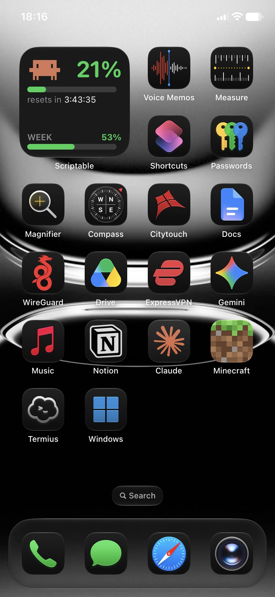
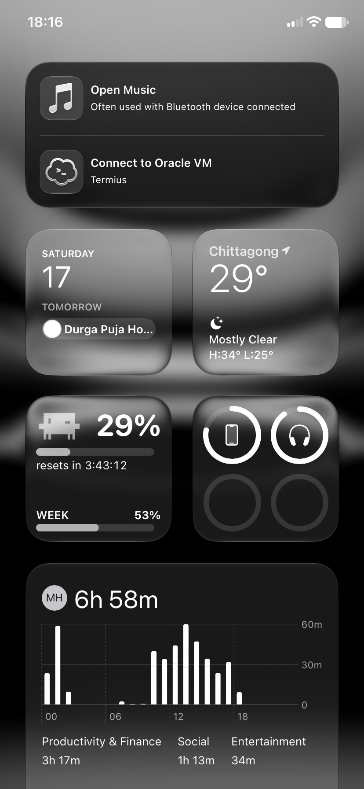
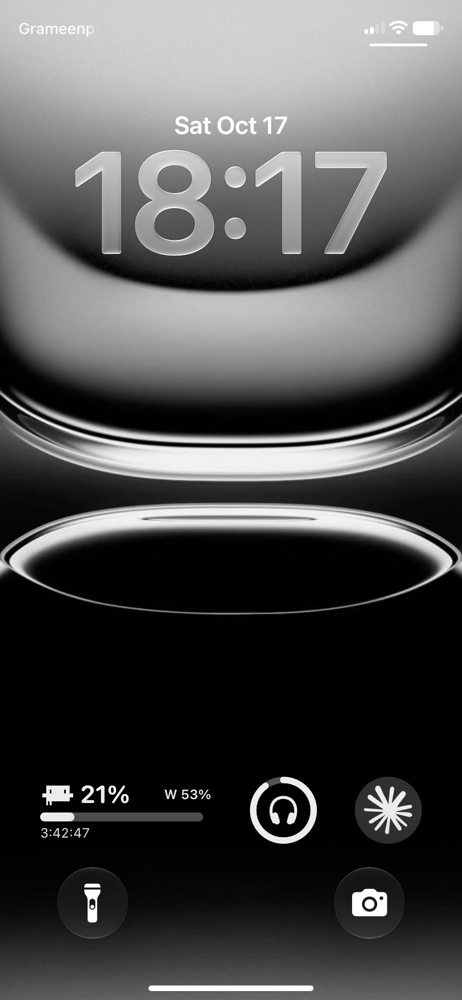

<div align="center">

# Claude Usage iOS Widget

**Your Claude plan limits on the iPhone Home Screen and Lock Screen, with an animated pixel Clawd.**

[](LICENSE)
[](https://scriptable.app)
[](https://scriptable.app)
[](#how-it-works)

</div>

<table>
  <tr>
    <td align="center"></td>
    <td align="center"></td>
    <td align="center"></td>
  </tr>
  <tr>
    <td align="center"><sub>Home Screen, dark</sub></td>
    <td align="center"><sub>Today View, Liquid Glass</sub></td>
    <td align="center"><sub>Lock Screen</sub></td>
  </tr>
</table>

The widget shows the same numbers as `/usage` in Claude Code: the current 5-hour session, the weekly limit
and, where your plan has one, the weekly Fable limit. Clawd, the crab from Claude Code's welcome screen,
reacts to them.

This is an iOS port of [clawd-usage-winwidget](https://github.com/Enhed/clawd-usage-winwidget) for Windows.

> [!NOTE]
> Unofficial community project. Not affiliated with or endorsed by Anthropic.

## Contents

- [Features](#features)
- [How it works](#how-it-works)
- [Requirements](#requirements)
- [Installation](#installation)
- [Widgets](#widgets)
- [Troubleshooting](#troubleshooting)
- [Privacy and security](#privacy-and-security)
- [Project structure](#project-structure)
- [Contributing](#contributing)
- [Acknowledgements](#acknowledgements)
- [License](#license)

## Features

- **Official numbers.** Read from `claude -p /usage`, the same source as Claude Code itself.
- **Zero tokens.** The `/usage` command never calls the model, and no API key is needed.
- **Home Screen and Lock Screen.** Small and medium widgets, plus inline, circular and rectangular
  Lock Screen widgets.
- **Liquid Glass ready.** Turns into glass on its own with the iOS 26 Clear Home Screen style.
- **Live countdown.** The time until your session resets ticks every second without using refresh budget.
- **Animated Clawd.** He changes pose with your usage on the widget, and plays the Claude Code animations
  at 60 ms per frame when you tap it.
- **No Mac or Xcode.** Runs in the free [Scriptable](https://scriptable.app) app.
- **Works anywhere.** The phone needs no VPN and no connection to your server.

## How it works

```
  Linux server (always on)                          GitHub                 iPhone
  ────────────────────────                          ──────                 ──────
  cron ─► publish.sh ─► probe.py ─► claude -p /usage
               │
               └─ upload on change ──────────►  secret Gist  ◄── fetch ──  Scriptable (widget.js)
                                                                            ├─ Home Screen widget
                                                                            ├─ Lock Screen widgets
                                                                            └─ tap: animated view
```

1. `probe.py` runs `claude -p /usage` with your existing Claude Code login and parses the session, weekly
   and Fable percentages and their reset times into JSON. A run reports `total_cost_usd: 0` and
   `num_turns: 0`.
2. `publish.sh` runs from cron every minute. Within that minute it probes about every 15 seconds and
   uploads to a secret GitHub Gist only when the numbers change, or after 5 minutes without an upload, so
   the widget can tell fresh data from stale.
3. `widget.js` fetches the Gist, bypassing GitHub's cache, and draws the widget. A failed fetch falls back
   to the last numbers, marked as stale.

## Requirements

| Where | What |
|---|---|
| Server | Any always-on Linux machine (a VPS or a home server) |
| | [Claude Code](https://docs.claude.com/en/docs/claude-code), installed and logged in |
| | Python 3.9 or later, `cron` and `flock` |
| | [GitHub CLI](https://cli.github.com) (`gh`) |
| GitHub | A classic personal access token with only the `gist` scope |
| iPhone | iOS 16 or later (for Lock Screen widgets) and [Scriptable](https://apps.apple.com/app/scriptable/id1405459188) |

## Installation

### 1. Server

**Clone the repository and check the probe:**

```sh
git clone https://github.com/intelQong/claude-usage-iOS-widget.git ~/claude-usage-iOS-widget
cd ~/claude-usage-iOS-widget
python3 probe.py --test   # parser self-check, prints "ok"
python3 probe.py          # prints your current limits as JSON
```

**Create a Gist-only token.** On GitHub, go to Settings → Developer settings → Personal access tokens →
**Tokens (classic)** and generate a token with only the **`gist`** scope. Save it on the server, readable
only by you:

```sh
nano ~/.gh_gist && chmod 600 ~/.gh_gist
```

**Create the secret Gist:**

```sh
mkdir -p ~/.cache/claude-usage
python3 probe.py > ~/.cache/claude-usage/usage.json
GH_TOKEN=$(cat ~/.gh_gist) gh gist create ~/.cache/claude-usage/usage.json -d "claude usage"
# → https://gist.github.com/<user>/<gist-id>

echo <gist-id> > ~/.cache/claude-usage/gist-id
```

**Schedule it** with `crontab -e`:

```cron
* * * * * $HOME/claude-usage-iOS-widget/publish.sh > $HOME/.cache/claude-usage/publish.log 2>&1
```

The job runs headless. It opens no terminal and adds nothing to your Claude Code sessions.

### 2. iPhone

1. Install **Scriptable**, tap **+**, paste in the contents of [`widget.js`](widget.js) and name the script
   *Claude Usage*.
2. Add a Scriptable widget to the Home Screen or Lock Screen.
3. Long-press the widget → **Edit Widget**, then set:

   | Setting | Value |
   |---|---|
   | Script | *Claude Usage* |
   | When Interacting | Run Script |
   | Parameter | `https://gist.githubusercontent.com/<user>/<gist-id>/raw/usage.json` |

   Set the Parameter on every widget you add. The script also remembers it, so tapping a widget works
   without it.

### Updating

Pull the repository on the server (`git pull`). On the iPhone, replace the script's contents with the new
`widget.js`; widget settings are kept.

## Widgets

| Family | Shows |
|---|---|
| Home Screen, small | Clawd, session %, bar, reset countdown, weekly % |
| Home Screen, medium | The same, plus the weekly Fable limit when your plan has one |
| Lock Screen, inline | `Claude 79% · week 50%` |
| Lock Screen, circular | A gauge ring with the session % |
| Lock Screen, rectangular | Clawd silhouette, session %, weekly %, bar, reset countdown |

Bars turn yellow at 60 % and red at 85 %. Lock Screen widgets are tinted by iOS to match your wallpaper.
With the iOS 26 **Clear** or **Tinted** Home Screen style, iOS renders the widget as Liquid Glass
automatically; nothing to configure.

**Clawd's mood** follows the session limit:

| State | Clawd |
|---|---|
| Window not started | Asleep, with a "z" |
| Window started in the last 15 minutes | Arms up, happy |
| Normal use | A random pose at each refresh |
| 85 % or more | Squinting and sweating |
| 100 % | Belly-up, X eyes |

**Tap any widget** to open the animated view: fresh numbers, a countdown that ticks every second, and Clawd
blinking and playing the Claude Code animations (jump, spin, peekaboo, waddle, wink, sneeze and more).
Tap Clawd for a heart.

> [!NOTE]
> iOS decides when widgets redraw, typically every 5–15 minutes, so the Home Screen can trail your real
> usage. The countdown is always live, and tapping a widget always fetches the latest numbers.

## Troubleshooting

| Symptom | Fix |
|---|---|
| Widget says *set your raw Gist URL as the widget Parameter* | Set the Parameter (step 3 of the iPhone setup). Use the **raw** `gist.githubusercontent.com` link, not the Gist page. |
| Widget shows *stale · Nm old* | The server stopped uploading. Check `~/.cache/claude-usage/publish.log`, or run `./publish.sh` by hand to see the error. |
| `probe.py` prints nothing and exits with 1 | Claude Code isn't logged in or isn't on `PATH`. Run `claude -p /usage` to check. |
| Upload fails with `HTTP 404` | The token is missing the `gist` scope, or `~/.cache/claude-usage/gist-id` is wrong. |
| Numbers lag behind Claude Code | Expected on the Home Screen (see the note above). Tap the widget for live numbers. |

## Privacy and security

- **What's published:** the session, weekly and Fable percentages, their reset times, and when the
  numbers were last updated. No email, account details, prompts or credentials.
- **Secret, not private:** a secret Gist is unlisted, but anyone with its link can read it. Don't share
  your Gist link, or a copy of `widget.js` with your link in it.
- **Least privilege:** the server uploads with a token limited to Gists, stored with `600` permissions.
  Your Claude Code login never leaves the server.
- **No inbound access:** the server only makes outgoing requests. It opens no ports, and the phone never
  connects to it.

## Project structure

```
.
├── probe.py      # runs `claude -p /usage`, prints the limits as JSON (--test: self-check)
├── publish.sh    # cron entry point: probes in a loop, uploads to the Gist on change
├── widget.js     # Scriptable script: Home Screen, Lock Screen and the animated tap view
├── docs/         # screenshots
├── LICENSE       # GNU GPL v3
└── NOTICE        # copyright and third-party notices
```

## Contributing

Issues and pull requests are welcome. Before opening a pull request:

- run `python3 probe.py --test`;
- for changes to `widget.js`, test the Home Screen, Lock Screen and tap view in Scriptable on a device;
- keep the dependencies at zero: Python's standard library on the server, plain Scriptable APIs on the phone.

## Acknowledgements

Clawd's sprites, animation sequences and the `/usage` parsing rules are ported from
[clawd-usage-winwidget](https://github.com/Enhed/clawd-usage-winwidget) by Venger Sergey, used under the
MIT License (see [NOTICE](NOTICE)). Clawd is the mascot from Claude Code's welcome screen.

## License

Copyright © 2026 intelQong.

Licensed under the [GNU General Public License v3.0](LICENSE) or later. You may use, modify and share this
software; anything you distribute that's based on it must also be released under the GPL v3.
